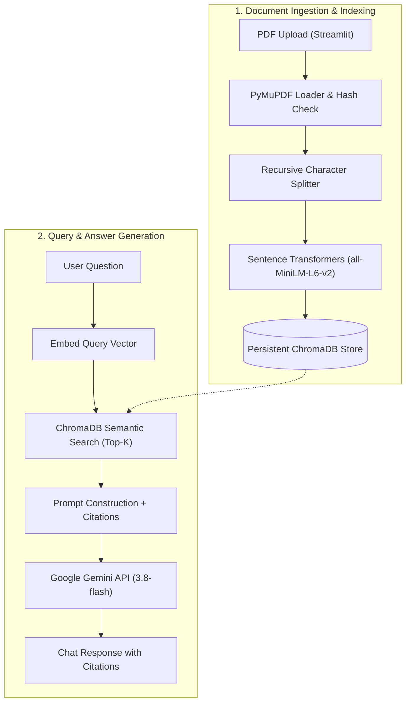

# 🧠 AI Knowledge Assistant (RAG Pipeline)

An end-to-end **Retrieval-Augmented Generation (RAG)** assistant built with **Streamlit**, **ChromaDB**, **Sentence Transformers**, **PyMuPDF**, and the **Google Gemini API**.

---

## 🌟 Key Features

- 📄 **Text-based PDF Extraction:** Extracts clean, selectable text page-by-page using PyMuPDF (`fitz`), preserving exact page numbers, document names, and page counts.
- 🧹 **Whitespace Normalization:** Carefully normalizes excessive whitespace and carriage returns while protecting code snippets, tables, and paragraph formatting.
- 🚫 **Empty Document Rejection:** Immediately rejects blank, scanned, or whitespace-only documents with a clear, user-friendly notice.
- 🧩 **Configurable Text Chunking:** Splits text using `RecursiveCharacterTextSplitter` with customizable chunk size and overlap, ensuring page attribution is never lost.
- 🔁 **Duplicate Document Detection:** Computes SHA-256 hashes of files to prevent re-indexing identical documents.
- 💾 **Persistent Vector Storage:** Stores embeddings and metadata persistently using ChromaDB.
- 🔍 **Semantic Search & Retrieval:** Uses `Sentence Transformers (all-MiniLM-L6-v2)` for dense vector search with configurable top-\(k\) and cosine similarity.
- 🤖 **Grounded Gemini Generation:** Synthesizes factual answers strictly from retrieved document excerpts.
- 📚 **Precise Source Citations:** Emits in-line citations with source filenames, page numbers, and preview excerpts.
- 🛡️ **Insufficient Context Handling:** Explicitly warns the user when documents do not contain enough information to answer a question truthfully, preventing hallucinations.
- 💻 **Polished Streamlit Chatbot UI:** Interactive interface with file upload progress, document manager, chat history, and expandable citation cards.
- 🧪 **Comprehensive Test Suite:** Unit and integration tests covering extraction, chunking, vector storage, generation, and pipeline flows.

---

## 🏗️ Architecture Overview

The system follows a standard, modular RAG pipeline:



### Module Structure

```
sumeet/
├── src/
│   ├── __init__.py           # Package marker
│   ├── config.py             # Environment variables and application config
│   ├── logger.py             # Centralized logging
│   ├── models.py             # Pydantic data models
│   ├── document_loader.py    # PyMuPDF extraction & SHA-256 duplicate handling
│   ├── text_splitter.py      # Recursive text chunking with metadata preservation
│   ├── embeddings.py         # SentenceTransformers embedding service
│   ├── vector_store.py       # Persistent ChromaDB client and CRUD operations
│   ├── retriever.py          # Semantic similarity retrieval & prompt formatting
│   ├── generator.py          # Gemini API generation & source citations
│   └── rag_pipeline.py       # End-to-end orchestrator
├── tests/
│   ├── conftest.py           # Pytest fixtures and mock services
│   ├── test_document_loader.py
│   ├── test_text_splitter.py
│   ├── test_vector_store.py
│   ├── test_generator.py
│   └── test_rag_pipeline.py
├── app.py                    # Streamlit web application
├── requirements.txt          # Python dependencies
├── .env.example              # Environment variables template
├── .gitignore                # Git ignore rules
└── README.md                 # Project documentation
```

---

## 🚀 Windows PowerShell Setup Guide

Follow these step-by-step instructions in **Windows PowerShell**:

### 1. Prerequisites
Ensure you have **Python 3.11** installed. You can check your available Python versions:
```powershell
py --list
```

### 2. Create and Activate Virtual Environment
Open PowerShell in the project directory:
```powershell
# If script execution is restricted on your machine, allow it for this process:
Set-ExecutionPolicy -Scope Process -ExecutionPolicy Bypass

# Create virtual environment with Python 3.11:
py -3.11 -m venv .venv

# Activate the virtual environment:
.\.venv\Scripts\Activate.ps1
```

### 3. Install Dependencies
```powershell
pip install -r requirements.txt
```

### 4. Configure Environment Variables
Copy the `.env.example` file to `.env`:
```powershell
Copy-Item .env.example .env
```
Open `.env` in a text editor (e.g., `notepad .env`) and add your Gemini API key:
```env
GEMINI_API_KEY=your_actual_gemini_api_key_here
GEMINI_MODEL=gemini-3.8-flash
CHROMA_PERSIST_DIRECTORY=./data/chroma
EMBEDDING_MODEL_NAME=all-MiniLM-L6-v2
CHUNK_SIZE=800
CHUNK_OVERLAP=150
TOP_K=4
```
> 💡 *Note: You can get a free Gemini API key at [Google AI Studio](https://aistudio.google.com/). You can also input the key directly in the Streamlit sidebar if preferred.*

---

## 🧪 Running Tests

The test suite validates every layer of the architecture:

```powershell
# Run all unit and integration tests:
pytest -v
```

---

## 🖥️ Running the Streamlit App

Launch the web interface:
```powershell
streamlit run app.py
```

The application will open automatically in your browser at `http://localhost:8501`.

### Using the App:
1. **Enter API Key:** If not set in `.env`, enter your Gemini API key in the sidebar.
2. **Upload PDF:** Drag & drop any PDF document into the sidebar uploader. The app will extract pages, generate embeddings, and persist them into ChromaDB.
3. **Ask Questions:** Type your questions into the chat bar.
4. **View Citations:** Expand the *Sources & Citations* card below each answer to review the exact source filename, page number, and text excerpt used.

---

## ⚙️ Configuration Reference

| Environment Variable | Default | Description |
| :--- | :--- | :--- |
| `GEMINI_API_KEY` | *(empty)* | Google Gemini API key from AI Studio |
| `GEMINI_MODEL` | `gemini-3.8-flash` | Gemini model to use (`gemini-3.8-flash`, `gemini-2.5-flash`, `gemini-2.5-pro`) |
| `CHROMA_PERSIST_DIRECTORY` | `./data/chroma` | Directory for persistent ChromaDB SQLite & vector index storage |
| `EMBEDDING_MODEL_NAME` | `all-MiniLM-L6-v2` | SentenceTransformer model for generating vector embeddings |
| `CHUNK_SIZE` | `800` | Target character count per document chunk |
| `CHUNK_OVERLAP` | `150` | Character overlap between consecutive chunks |
| `TOP_K` | `4` | Number of most relevant chunks retrieved per query |

---

## 🛡️ Error Handling & Safeguards

- **Corrupted / Non-PDF Files:** Validates `%PDF` magic bytes and rejects malformed files before parsing.
- **Empty Documents:** Detects 0-byte or blank documents and provides informative feedback.
- **Duplicate Document Ingestion:** Uses SHA-256 content hashing to avoid redundant chunking and vector storage.
- **Insufficient Context:** Strict system prompting and programmatic detection ensure the assistant explicitly states when uploaded documents lack the requested answers.
- **Secret Isolation:** API keys are never stored in the database or committed to Git; all sensitive keys are loaded via environment variables or session memory.

